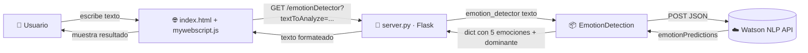
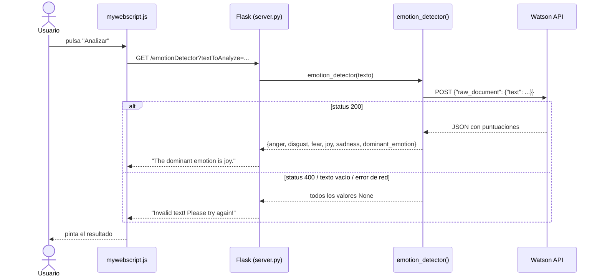
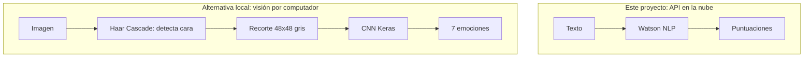

# 🎭 Emotion Detector · Detección de emociones con IA (Watson NLP + Flask)

[](https://github.com/TereBytes/oaqjp-final-project-emb-ai/actions)


Aplicación web que recibe una frase en inglés, la envía a un modelo de IA de **IBM Watson NLP** y devuelve la puntuación de cinco emociones (**anger, disgust, fear, joy, sadness**) junto con la **emoción dominante**.

> Proyecto final del curso *Developing AI Applications with Python and Flask* (IBM / Coursera), ampliado con tests, CI, manejo de errores y documentación didáctica.

---

## 📑 Índice

1. [¿Qué hace?](#-qué-hace)
2. [Arquitectura](#-arquitectura)
3. [Estructura del repositorio](#-estructura-del-repositorio)
4. [Instalación y uso](#-instalación-y-uso)
5. [Paso a paso: cómo se construye](#-paso-a-paso-cómo-se-construye)
6. [Conceptos clave para aprender](#-conceptos-clave-para-aprender)
7. [Tests y calidad de código](#-tests-y-calidad-de-código)
8. [Ideas para ampliarlo](#-ideas-para-ampliarlo)
9. [Repositorios de referencia](#-repositorios-de-referencia)

---

## ✨ ¿Qué hace?

| Entrada | Salida |
|---|---|
| `I love my life` | Cinco puntuaciones entre 0 y 1 (valores de ejemplo: `joy: 0.97`, resto cercano a 0) → **joy** |
| *(texto vacío)* | `Invalid text! Please try again!` |

## 🏗 Arquitectura



### Flujo de una petición



## 🗂 Estructura del repositorio

```
oaqjp-final-project-emb-ai/
├── EmotionDetection/            # ← paquete Python reutilizable
│   ├── __init__.py              #   expone emotion_detector
│   └── emotion_detection.py     #   llamada a la API + parseo
├── templates/index.html         # interfaz (Bootstrap)
├── static/mywebscript.js        # llamada al backend con fetch
├── server.py                    # aplicación Flask
├── test_emotion_detection.py    # tests del paquete (sin red, con mocks)
├── test_server.py               # tests de las rutas Flask
├── requirements.txt
├── .github/workflows/ci.yml     # tests + pylint en cada push
└── README.md
```

## 🚀 Instalación y uso

```bash
git clone https://github.com/TereBytes/oaqjp-final-project-emb-ai.git
cd oaqjp-final-project-emb-ai
python -m venv .venv && source .venv/bin/activate   # Windows: .venv\Scripts\activate
pip install -r requirements.txt
python server.py
```

Abre <http://localhost:5000>.

> ⚠️ El endpoint de Watson (`sn-watson-emotion.labs.skills.network`) es el del laboratorio de IBM Skills Network y **puede no estar accesible fuera de él**. Si es tu caso, usa tu propio endpoint con la variable de entorno `WATSON_EMOTION_URL`, o ejecuta solo los tests (funcionan sin red).

---

## 🧭 Paso a paso: cómo se construye

### Tarea 1 · Entender la API
Watson recibe un JSON y responde con una puntuación (0–1) por emoción.

```text
POST …/EmotionPredict
Header:  grpc-metadata-mlmodel-id: emotion_aggregated-workflow_lang_en_stock
Body:    {"raw_document": {"text": "I love my life"}}
```

### Tarea 2 · Función `emotion_detector`
1. Construir cabecera y cuerpo.
2. `requests.post(url, json=..., headers=..., timeout=...)`.
3. Decodificar con `response.json()`.
4. Devolver el resultado.

### Tarea 3 · Formatear la salida
Pasar de `{"emotionPredictions": [{"emotion": {...}}]}` a un diccionario plano y añadir `dominant_emotion = max(emociones, key=puntuación)`.

### Tarea 4 · Convertirlo en paquete
Carpeta `EmotionDetection/` con `__init__.py`. Así se importa con `from EmotionDetection.emotion_detection import emotion_detector`.

### Tarea 5 · Servidor Flask
Dos rutas: `/` (página) y `/emotionDetector` (API que lee `textToAnalyze` de la query string).

### Tarea 6 · Tests unitarios
`unittest` con una frase por emoción (`joy`, `anger`, `disgust`, `sadness`, `fear`). Se simula Watson con `unittest.mock.patch` para que sean rápidos y deterministas.

### Tarea 7 · Manejo de errores
Texto vacío o estado 400 → todas las claves a `None` → el servidor responde `Invalid text! Please try again!` sin lanzar excepciones.

### Tarea 8 · Análisis estático
`pylint EmotionDetection server.py` (objetivo: 10/10).

### Tarea 9 · Entrega
Capturas de pantalla de cada tarea + URL del repositorio.

---

## 🧠 Conceptos clave para aprender

| Concepto | Idea en una línea | Dónde verlo |
|---|---|---|
| **API REST** | Comunicarse con otro servicio por HTTP + JSON | `requests.post` |
| **Código de estado HTTP** | 200 = OK, 400 = petición incorrecta | `status_code` |
| **Paquete Python** | Carpeta con `__init__.py` que se puede importar | `EmotionDetection/` |
| **Flask y rutas** | Funciones que responden a una URL | `@app.route` |
| **Query string** | Datos en la URL: `?clave=valor` | `request.args.get` |
| **Mocking** | Sustituir una dependencia externa en los tests | `patch(...)` |
| **Manejo de errores** | Devolver valores seguros en vez de romper | `_empty_result()` |
| **Análisis estático** | Revisar estilo y fallos sin ejecutar | `pylint` |
| **CI** | Ejecutar tests automáticamente en cada push | `.github/workflows` |
| **NLP de emociones** | Modelo que clasifica texto en categorías emocionales | Watson NLP |

### De la lista al modelo: dos formas de detectar emociones



El repositorio [viperadnan-git/emotion-detection](https://github.com/viperadnan-git/emotion-detection) sigue el camino B: detecta caras con OpenCV, las recorta y las clasifica con un modelo Keras. Es un buen siguiente paso para comparar enfoques.

---

## 🧪 Tests y calidad de código

```bash
python -m unittest -v        # 8 tests
pylint EmotionDetection server.py
```

## 💡 Ideas para ampliarlo

- [ ] Gráfico de barras con las 5 emociones en la interfaz (Chart.js).
- [ ] Endpoint JSON (`/api/emotions`) además del texto plano.
- [ ] Dockerfile y despliegue gratuito (Render / Fly.io) con enlace *live demo*.
- [ ] Alternativa gratuita y local con Hugging Face `transformers` (modelo de emociones).
- [ ] Soporte multiidioma (traducir antes de analizar).
- [ ] Historial de análisis con SQLite.

## 📚 Repositorios de referencia

- [viperadnan-git/emotion-detection](https://github.com/viperadnan-git/emotion-detection) · emociones en imágenes con OpenCV + Keras
- [ibm-developer-skills-network/oaqjp-final-project-emb-ai](https://github.com/ibm-developer-skills-network/oaqjp-final-project-emb-ai) · plantilla original del curso

## 📄 Licencia

Consulta el archivo [LICENSE](LICENSE), heredado del repositorio original.
